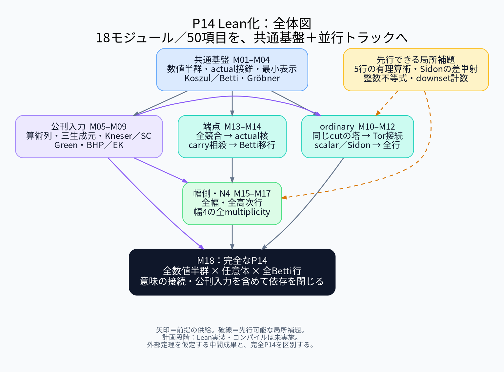

# P14 Lean化 全体図・モジュール別計画 R01

2026年11月9日（JST）。ユーザーから監査PASSの連絡を受け、V03の主証明をLeanへ移すための計画を作成した。
今回の成果物は計画とライブラリ調査であり、Leanのインストール・実装・コンパイルはまだ行っていない。

**方針：V03の50項目を18モジュールに分け、実際の接錐とBetti数の意味を共通基盤で固定する。
算術・有限組合せを先行し、ordinary・端点／幅側・公刊入力を並行して閉じる。**
主ルートはApéry–Sidon＋scalar、N4紙上置換のまま維持する。

## 1. 最初に見る全体図

図の矢印は「前提を供給する」方向である。18モジュールの詳細な依存はmodules.jsonに記録する。
先行可能な小補題と、その補題をactual sourceへ接続してモジュール全体を完成させる工程は区別する。

~~~mermaid
flowchart TD
  F["数値半群・actual接錐・最小表示 M01–M02"]
  K["Koszul／Betti・次元比較・Gröbner M03–M04"]
  P["公刊入力の形式証明 M05–M09"]
  A["先行：有理計算・Sidon差単射・downset"]
  O["ordinary：同じcutの塔→Tor→scalar M10–M12"]
  E["端点：全競合→actual核→Betti移行 M13–M14"]
  N["幅側・N4・幅4の全m M15–M17"]
  M["全域・全行・任意体のP14 M18"]
  F --> K
  F --> P
  K --> P
  F --> O
  K --> O
  P --> O
  F --> E
  K --> E
  E --> N
  P --> N
  A --> O
  A --> N
  O --> M
  N --> M
  P --> M
~~~

これは理解用の縮約図であり、全公刊入力が両枝の全部に必要という意味ではない。
具体的にはGreenはordinary、BHP/EKは幅側dense、Kneser/SCは該当する加法・N4部分、
算術列公式はtargetとedge、三生成元定理は小生成元数で使う。

## 2. 何を「Lean化完了」と数えるか

最終定理は、任意の体、真正な全数値半群、全Betti行について、元のactual tangent coneと
actual interval completionを、それぞれの最小多項式表示で比較する。

| 到達点 | 認める成果 | まだ完了していないもの |
|---|---|---|
|局所補題|整数・有理数・有限群・行列などの普遍的補題がLeanで証明される|その量がactual接錐・同じcutから来る接続|
|条件付き全域定理|actual source、Bettiの意味、A–Dの橋、全域合成が証明され、公刊入力だけが明示的な引数として残る|残した公刊入力の形式証明|
|完全なP14|公刊入力又は十分な特殊版も証明され、最終定理の依存閉包が閉じる|保守・将来の拡張|

定理の型、コンパイルする空の構造体、論文の引用、未証明入力を渡した最終定理は、
それぞれ有用な途中成果だが、完全P14とは報告しない。
通常のLean論理基盤を認めたうえで、sorryAx、新しい数学的公理、隠れた未証明入力を最終依存へ残さない。

## 3. 今あるものと、新しく作るもの

### 3.1 ワークスペース

調査時点でLean・lake・elanはPATH上になく、プロジェクト内に
.lean、lean-toolchain、lakefile、lake-manifestはなかった。
V03の紙上証明・監査・算術コードが出発点である。
この事実からLeanを実行した、又は既に一部の証明がLean化されたとはしない。

### 3.2 mathlibの調査

調査基準はmathlib commit
139105d28c7685a154cb3093f79edb2e16708099、
対応toolchainはleanprover/lean4:v4.36.0-rc2。
実装の最初にLeanとmathlibを整合する組で固定する。調査HEADが安定版という意味ではない。

| 分野 | 確認できた再利用 | まだプロジェクトで接続すべきもの |
|---|---|---|
|数値半群|加法部分モノイド、gcd倍数の十分大きい数の所属、有限生成、Frobenius数|Apéry・atom・最大表示長・実接錐との専用API|
|接錐／graded|Rees代数、冪idealの係数条件、Noetherianな商、grading、adic completion|Rees商の各graded pieceと実際の完成半群環の接錐との同値|
|同調代数|projective resolution、具体的なkernel/image homology、長完全列、rank-nullity、抽象spectral sequence|本稿で使うKoszul、Bettiとの一致、有限性、具体的な二重複体比較|
|単項式|monomial order、leading term、除算・reduction|必要な標準単項式の基底、初期加群rank比較、幅4のexact initial ideal|
|公刊7入力|今回の検索でexactに適用できる既存形式定理は確認できず|既存定理の追加探索・コンパイル確認、又は必要なstatementの形式証明|

特に、Tor.leanはTorの定義とprojective消滅を持つが、Tor/Tor'の比較を今後の仕事と明記している。
一般の同調代数が全部ないわけでも、名前があるので今回の比較がそのまま使えるわけでもない。

公開ソース59項目の根拠と検索範囲は
[ライブラリ調査](P14_LEAN_LIBRARY_AUDIT.md)、
機械可読な記録はmathlib_inventory.jsonに保存した。
「未確認」は、別名の同値定理が存在しないことの証明ではない。
今回は実際のimportや適用のコンパイルはしていない。

## 4. 実装方式の比較と推奨

| 方式 | 利点 | 代償・完成条件 |
|---|---|---|
|一般のgraded minimal resolution／derived Torから始める|公刊定理や一般論と表現が近い|本稿以上の一般理論・自然性・有限性の整備が先行しやすい|
|実変数Koszul homologyを中心にする：推奨|有限長の変数列、単位minor、具体的な2・3行複体に直接対応する|通常のBetti/Torとの一致と、homologyの有限性を証明する必要がある|
|公刊入力や接続を未証明引数にして先に組む|型と依存の設計、局所検証が早い|条件付きの中間成果。完成P14への追加工数は残る|

推奨は第二方式を主設計とし、第三方式を進捗の明示に限定して使うこと。
これは主証明の数学的ルートを変更する提案ではなく、同じ内容をLeanで表す方法の選択である。
必要な特殊版で十分ならそれを証明し、公刊定理の全一般化を無制限に移植しない。

### 4.1 必ず先に固定する四つの契約

1. **actual cone契約。** 数値基底・半群環・Rees商を実装に使ってよいが、
   元のgr k[[t^Γ]]とのgraded algebra同値を証明する。完成環の同値を無言で省略しない。
2. **Betti契約。** 最小表示の実変数に関するKoszul homologyで計算し、通常のBetti/Torと一致させる。
   sourceとtargetの変数数を別に保持する。
3. **有限性契約。** homologyの有限次元性・totalの有限台を先に証明する。
   chain group自体は無限次元になり得る。無限次元でのfinrankの0を消滅証明に流用しない。
4. **witness契約。** ordinaryのsource・体・cut・塔・資源列を一つの証明付きデータで持つ。
   端点側も元のsource・全競合・actual核を同じデータで保持する。

## 5. 全18モジュールと期間の概算

**単位は実働人日。1人日＝熟練したLean数学者がAIを使って約6時間集中する作業量。**
10人日は約2作業週。各行は前提モジュールが完成した後の追加工数であり、
前提の開発費を毎行重複計上しない。
型付け・証明・意味の接続・通常の局所レビューを含む、実測前の企画レンジである。
AIの単独実行時間・納期・統計的信頼区間ではない。

| ID | モジュール | 前提完成後の追加工数 | 主な前提 |
|---|---|---:|---|
| M01 | 数値半群・有限組合せ基盤 | 35–90人日 | mathlib基礎 |
| M02 | actual tangent cone・最小表示 | 50–140人日 | M01 |
| M03 | graded Koszul/Tor・必要な同調代数 | 100–280人日 | M01, M04 |
| M04 | 初期加群・Gröbner・標準単項式 | 50–150人日 | M01 |
| M05 | 算術列の全証明・actual target | 80–220人日 | M01, M02, M03, M04 |
| M06 | 三生成元の公刊比較 | 60–180人日 | M01, M02, M03, M04, M05 |
| M07 | Kneser・長零和自由列 | 70–200人日 | M01 |
| M08 | Green・Hilbert restriction | 70–220人日 | M03, M04 |
| M09 | BHP/Pardue・Eliahou–Kervaire | 100–300人日 | M03, M04, M08 |
| M10 | ordinary の actual 座標・一つの cut・塔 | 55–140人日 | M01, M02, M03, M08 |
| M11 | harmonic rank・Tor 鎖・target 係数 | 50–140人日 | M03, M04, M05, M10 |
| M12 | ordinary の scalar と全域閉鎖 | 25–65人日 | M03, M05, M10, M11 |
| M13 | 狭幅正規化・端点 core から actual 核 | 45–120人日 | M01, M02, M03, M04 |
| M14 | Artin/Koszul 計数と actual Betti 移行 | 25–70人日 | M03, M04, M13 |
| M15 | 五生成元以上の全幅 | 45–130人日 | M05, M07, M09, M13, M14 |
| M16 | N4 の距離・標準語・第一行・高次行 | 30–85人日 | M05, M07, M13, M14 |
| M17 | 幅4の全 m と N4 閉鎖 | 20–65人日 | M02, M03, M04, M05, M13, M16 |
| M18 | 小生成元・分割・主定理 | 8–25人日 | M01, M02, M03, M04, M05, M06, M12, M13, M15, M17 |

M00として環境固定・CI・計測準備を別途2–5人日置く。
公刊入力はM05–M09が所有し、文献を新しいaxiomとして置く費用ではなく、必要な形式証明まで含める。
各モジュールの全50項目への割当、具体的な作業・受入条件・前提は
[詳細モジュール表](P14_LEAN_MODULE_CATALOGUE_JA.md) とmodules.jsonを参照。

公刊7入力の暫定的な配賦は次のとおり。M05・M07の分割は予算配賦であり、
原典の依存を形式化して実測した値ではない。各行は上のモジュール工数の内数で、追加計上しない。

| 入力 | 所有 | 人日 |
|---|---|---:|
|算術列Betti公式と適用|M05の一部|50–150|
|算術列と接錐のBetti一致・接続|M05の一部|30–70|
|三生成元の比較|M06|60–180|
|Kneserと必要な反復版|M07の一部|35–95|
|Savchev–Chenの長零和自由列|M07の一部|35–105|
|Green次数2の必要範囲|M08|70–220|
|BHP/Pardue＋EKの必要範囲|M09|100–300|

### 5.1 工数の集約

| 作業群 | 該当 | 人日 |
|---|---|---:|
|環境・固定・計測準備|M00|2–5|
|数値半群・実接錐・共通代数|M01–M04|235–660|
|公刊入力とactual target|M05–M09|380–1,120|
|ordinary本体|M10–M12|130–345|
|端点・actual核・Betti移行|M13–M14|70–190|
|五生成元以上・N4・幅4|M15–M17|95–280|
|全域合成|M18|8–25|
|**計**|**前提の二重計上なし**|**920–2,625**|

公刊入力を証明済み引数として受けるactualな条件付きP14までの作業量は、
M05–M09のうち公刊証明とtarget適用を分離しないまま丸ごと差し引いて計算してはいけない。
targetのatom・公式への代入・最小表示・添字等の接続は条件付き段階でも必要である。
したがって、この計画では「条件付きなら何日で完成」という別の正確そうな総数を置かない。

### 5.2 暦期間の読み方

全体は公刊入力と共通基盤を含む研究開発であり、現時点では**数人年規模**の予備見積となる。
1人が月20作業日のうち80%を本件へ割り当てると月16人日なので、
上の工数の単純換算は約58–164か月、約5–14年に相当する。
これは現在の実測納期でも、この年数が必要だという下限の主張でもない。

3–4人の熟練者＋各自AIなら独立トラックを並行できるが、全体を人数で割った値を納期にしない。
数値モデル・Koszul/Betti・Green/BHP・実引数による統合には先行関係がある。
粗い18モジュールを一個ずつ完了して次へ渡す保守的な工程でも年単位となる。
下位ファイルへ分けた先行APIの共有で短縮できるため、試作後に具体的な暦工程を再計算する。
現段階で固定するのはモジュールと校正手順であり、完成日は固定しない。

強い再利用定理が見つかる、特殊版の証明が短くなる、AIの実測速度が高い場合は、
該当行を根拠付きで下げる。逆に原典の追加補題が多い場合は上端を超え得る。
局所有理数補題の速度を、大域的な可換代数へそのまま外挿しない。

## 6. 並行作業の組み方

| トラック | 主作業 | 他トラックへ渡すもの |
|---|---|---|
|A：数値・算術|M01、M12の数値submodule、Sidon差単射、M16のdownset計数|表・普遍不等式・有限集合の単射|
|B：意味と共通代数|M02–M04、M13–M14の基盤|actual cone、Betti、有限性、完全列と核の接続|
|C：公刊入力|M05–M09をさらに7入力に分業|仮定・添字・標数が一致する形式定理|
|D：本体・統合|M10–M18のapplicationとstatement review|A–Dの橋、各枝、最後のactualなP14|

初期はA/B/Cを優先し、Dの担当はinterfaceの整合を早く確認する。
M12の数値補題は、M10が終わるまで待たず、有限資源列を仮定した普遍的定理として証明できる。
その後でM10のactual witnessを供給する。前提付き局所補題と枝全体の完了は区別する。

公刊入力を一つの巨大ファイルから一括importしない。算術列targetを作るために
三生成元P14まで待つ、といった循環を避ける。
M03/M04、M08のHilbert/Macaulay補助部も分割し、必要なexportだけを共有する。

## 7. 最初の10–20人日で見積を校正する

M00の準備後に、次の小試作を行う。時間枠は完了の保証ではなく測定予算であり、
関連するM01–M04/M10–M12等の内数として扱う。

| 試作 | 時間枠 | 観測したいもの | 出口 |
|---|---:|---|---|
|A：scalarの普遍恒等式＋5行の一つ|3–5人日|整数添字、floor/ceil、有限和、有理不等式の証明速度|抽象資源に対する実証明。actual Bettiまで完了したとはしない|
|B：Rees商／小半群の接錐モデル|3–5人日|graded pieceと数値基底、完成環からの同値で何が再利用できるか|一つの意味の接続、又は未完前提を具体的に記録|
|C：小さなKoszul・完全列の次元比較|4–10人日|複体・homology・有限性・型搬送の実際の費用|既存complexへ接続した補題、又は不足APIの特定|
|**計測枠合計**|**10–20人日**|**大域計画を更新する根拠**|**未完を隠さず次の範囲を決める**|

各試作で、人の集中時間、AI実行・反復・レビュー、再利用できた宣言、
新規の前提数、閉じたtheorem、残る引数、clean buildとaxiom依存を測る。
この段階で18行の見積を改訂し、次の4–8作業週の実装対象を固定する。

最初の本格的な縦の到達点は、二生成元をactual objectsから
\(G_\Gamma\simeq k[x,y]/(y^m)\)、\(\beta=(1,1,0,\ldots)\)、actual target比較まで閉じること。
単にこの商環を先に仮定しない。
目安15–40人日、接錐/Koszul基盤から作る場合40–100人日以上で、関連モジュールの内数である。
これを最初の試作10–20人日で必ず全完するという約束にはしない。

## 8. 完了ゲート

| Gate | 必要な証拠 |
|---|---|
|G0：環境・契約|固定Lean/mathlib、主定理の意味、最小表示、信頼基盤、再現可能なbuild|
|G1：局所補題|普遍statementの実証明。数値サンプル・外部JSONを仮定しない|
|G2：意味の基盤|完成半群環との接錐同値、Koszul/Betti一致、有限性、同標数base change|
|G3：主要な橋|ordinaryの同jump/Tor/target、端点のactual核/carry/Tor補償、幅4のexact initial ideal|
|G4：公刊入力|7入力の証明又は必要範囲の証明済み代替。型付きaxiomで置き換えない|
|G5：完全P14|任意体・全真正半群・全行で主定理を実引数から閉じ、依存を監査しclean build|

G1と公刊入力の一部はG2と並行できる。G5はG2–G4の実証明が揃ってから数える。
進捗は「50個の宣言中何個あるか」でなく、各theoremの局所proofと実際の接続状態で記録する。

## 9. 予定するファイル構成

以下は計画であり、.leanファイルを今回作ったという意味ではない。

~~~text
NSP14/
  Foundations/   NumericalSemigroup, Apery, Orders, FiniteCounting
  TangentCone/   SemigroupAlgebra, Completion, AssociatedGraded, ModelEquiv, Presentation
  Homology/      Koszul, Betti, Finiteness, ExactSequence, BoundedComparison, BaseChange
  Groebner/      Division, StandardMonomials, InitialModule, RankComparison
  Published/     APBetti, APCone, SpaceCurve, Kneser, SavchevChen, GreenDegreeTwo, LexBetti
  Ordinary/      Coordinates, Paths, Cut, Tower, Harmonic, TorBridge, TargetBridge,
                 Sidon, ScalarSmall, ScalarLarge, Closure
  Endpoint/      Core, Coordinates, Kernel, Stopping, CarryBounds, Homology,
                 BettiTransfer, ArtinBounds
  Narrow/        Edge, Dense, Sparse, FiveGenerators
  N4/            Distance, Words, FirstRow, HigherRows, SmallWidths, WidthFour, Closure
  Main.lean
  TrustAudit.lean
~~~

初期CIではlake buildと、最終定理・主要exportのaxiom依存を確認する。
kernelが証明項を検査できる算術手段を使い、外部Pythonの出力は仕様照合・証書生成に限定する。
その出力自体を定理の証明として信頼しない。

## 10. 計画の不確実性と次の一手

今回の工数は、人による実装実測前の判断である。最も不確実なのは、
実接錐の同値、Koszul/Betti接続、正標数を含むBHP、算術列・三生成元の公刊証明の補題群。
調査で再利用基盤は確認したが、NS-P14のimportが実際に通ることまでは確認していない。

次の着手単位はM00と第7節の校正試作。
この計画段階では数学の主ルートを変更せず、旧83組・196組・Navi別証明を主依存へ戻さない。
V03とすべての監査資料はそのまま保存する。
