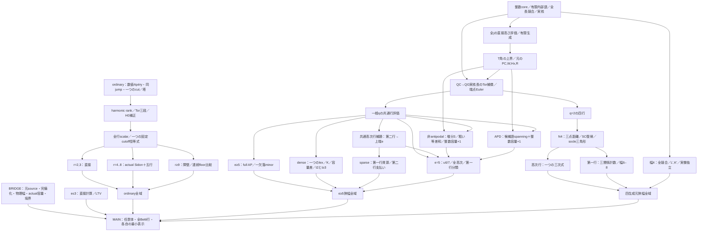

# V06：短縮後の依存と全域被覆

読解基準は work `345e2d82fea50ef89e00a8f35c4fb53ac601d7ce`。
下図の矢印は入力から結論へ向く。公刊入力の一般的再証明は含めない。

APD.2 は一般距離和・E-ARTIN・実核補償E-TORを使う。APD.3 は幅章の全高次行を再確認する
適用説明であり、APD.2の前提ではない。W-FIVE-FIRST→APD.2→W-FIVE-FIRSTという循環はない。
E-TORは有限内部語によるE有限性を使う。V06ではE-STOPの明示的周期停止式自体を
主証明から外し、全jの核同定と直接の高さ評価から必要な有限生成性・純v冪・socleへ進む。
消したのは停止回数の強い結論であり、全ての長い表示を扱う実核同定ではない。

V05の共通高次行補題は \(e\ge2,u\ge e\) の数値命題として証明し、
元の実核補償後の行評価と合わせて使う。疎幅固有の第二行支払いを五生成元へ持ち出さず、
五生成元側では \(u=8\) の尾和14と \(u\ge9\) の第二行三次式を保持する。
非antipodalの第一行では \(6W\le u^2+u+6\) を使い、剰余別の正確な体積式を要求しない。

denseではt=2を保持し、3≤t≤qではr=tを選ぶ。同じ差の係数の6倍を
\(12(q-4)+5(t-3)^2+(t-3)+6(t-3)(q-t)\) として非負性を一度に示す。
q=4,t=3では係数が0であり、strict positivityを要求しない。

## A・B・Cの分類

| 分類 | 内容 | 扱い |
|---|---|---|
| A：必要な核心 | ordinary同jump strata／同じcutの資源／rankとTor／actual Sidon、端点の全競合・実核補償、denseのwhole-Hilbert lex、N4のSC復帰・三角形・幅4 | 証明を本文化して保持 |
| B：共通接続 | 完備化、同標数体拡大、元sourceの正規化記述、物理幅、actual target、0行・上方行 | BRIDGEへ共通化 |
| B：同型の算術 | 小／大ordinaryの二変数差分、denseの容量差、sparse第二行、疎幅／五生成元の全高次行移行 | 一つの恒等式または共通補題に統合 |
| C：不要な強化 | exact antipodal presentation・P/W/b1、N角からのR厳密算出、ordinary余剰Γ全式、N4四次・五次支払い | 数学的依存から除去。必須付録にもしない |
| C：V05でさらに不要化 | 非antipodalの三剰余公式とu8例外、五生成元第3–5行の粗い個別上界・三基点・二項係数/u²の単調性 | 本文と主依存から除去。既存結果を必須付録にも移さない |
| C：V06でさらに不要化 | 全競合の具体的周期停止回数とcarry表、denseのt3専用支払いとt4基点 | 必要な高さ・有限性・非負性の直接証明へ置換 |
| C：既に外れていた別経路 | 196組、83組・665比較・5tail、Navi増分 | 再導入しない。今回新たに削減した量には算入しない |

## パラメータとBetti行の被覆

| 領域 | 全ての分割 | 有効条件 | 行 |
|---|---|---|---|
| 小生成元 | e=1／2／3 | e1は空gcdを定義しない。e3はLTV | 全i≥0 |
| ordinary | w≥m−1、r=2,3／4..8／≥9 | r≤e−1。r≥3はδ≥a_r。r≥9はe≥10。r6..8の角はactual Sidonで除外 | 1≤i≤eを証明、0行とi>eはBRIDGE |
| e≥6狭幅 | u=e−1／e／e+1..2e−3／≥2e−2 | q=e−2、d≥1、m≥du+2、collective gcd条件 | 同上、i=eも保持 |
| e=5狭幅 | u=4／5／6,7／≥8 | u≥8の全高次行は構造によらない。第一行だけantipodal分類 | 同上 |
| e=4狭幅・第一行 | u=3,4／5／6,7,8／≥9 | 幅4最後の族はm=6／m>6の全四剰余 | i=1 |
| e=4狭幅・高次 | u=3／4／5／≥6 | u≥6だけ新cubic。小幅の床とactual容量を保持 | i=2,3,4 |

- w=m−1はordinary側。狭幅ではu≤du≤m−2、最小境界m=du+2を含む。
- full APのd=1はsource=targetを使う。一般Fmin(u)による無理な支払いをしない。
- i=eを「source消滅」としない。i>eで初めてHilbert syzygyを使う。
- i>eでtargetが生きる場合も許す。u=4のtarget第4行最小値は1、source上界0と区別する。
- MINCAPの単調性は固定iに対してv≥iの範囲で使う。v<iにはactualの0行を適用する。
- 偶奇、床、負二項添字、max(Hx−2,0)、実核長PC−PGは本文で定義域を明示する。

## 除外した結果の再流入点検

| 除外対象 | 他枝での必要性 |
|---|---|
| exact antipodal四モジュール | Width.Closureの再帰importからAntipodalBasis/Presentation/Ideal/Volumeへ到達しない。宣言名の他production参照も比較ルートにない |
| exact N_s全角 | 幅担当・N4担当が、実Rの定義とR≤Rhatだけを使用すると確認。幅4は独自の全競合を直接処理 |
| ordinary Γ_j全式 | targetへの十分な下界だけを使用。O6以降にΓ_jなし |
| old四次・五次N4比較 | N4b–cと小幅表が全高次行を閉じる。他枝は使用しない |
| 非antipodalの三剰余別公式・u8第一行特例 | 十分な尾和上界と整数性に置換。他枝は使用しない |
| 五生成元の二項係数/u²単調性・三基点 | 共通高次行補題に置換。N4は独自の既存二項係数比を保持し、この削除対象を使用しない |
| E-STOPの周期p・J0+pという具体的停止値 | E有限性はE-FIBER、T_sの有限生成性は始点の第一座標有界性から直接得る。幅4は独自に全競合を処理する |
| denseのt3専用支払い | t≥3の同じ非負係数式に包含。q3のu6/7資源評価を変更しない |
| 旧列挙証書 | 本文の数学的前提、DAG、数値入力に含めない |

既存Leanの集約importが独立成果を公開することは、紙上主証明の数学的依存とは区別する。
既存Leanが停止定理を利用する実装を保持することと、新しい紙上経路がその強い結論を要求することも区別する。
今回行ったのは読解・静的照合・新稿の独立レビューであり、新しいLean全域認証ではない。
